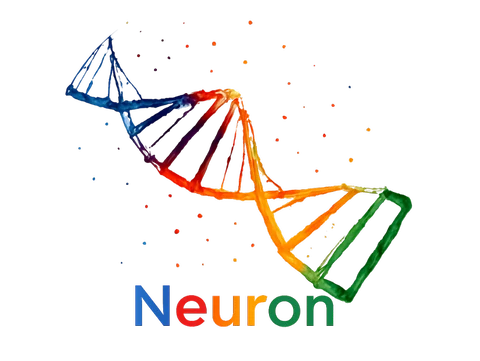
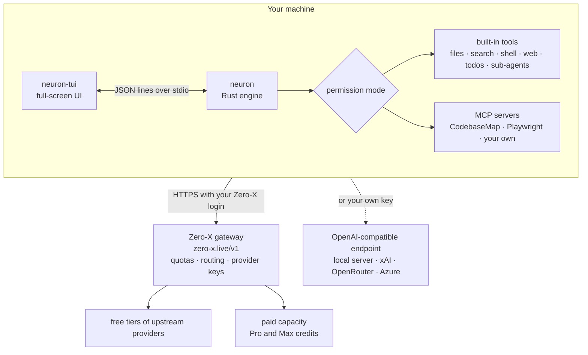

<h1 align="center">
  <picture>
    <source media="(prefers-color-scheme: dark)" srcset="assets/readme/neuron-logo-dark.webp">
    <source media="(prefers-color-scheme: light)" srcset="assets/readme/neuron-logo-light.webp">
    
  </picture>
</h1>

<p align="center"><strong>An open-source AI coding agent for your terminal.</strong></p>

<p align="center">
Neuron reads your project, edits files and runs your tests, and asks before anything
your permission mode does not allow. Sign in once for free daily usage on hosted models
from several providers, or bring your own key.
</p>

<p align="center">
  <a href="https://github.com/RAHUL-DevelopeRR/neuron-v2/releases"></a>
  <a href="https://github.com/RAHUL-DevelopeRR/neuron-v2/actions/workflows/rust-ci.yml"></a>
  <a href="https://github.com/RAHUL-DevelopeRR/neuron-v2/actions/workflows/packaging-ci.yml"></a>
  <a href="https://github.com/RAHUL-DevelopeRR/neuron-v2/blob/HEAD/LICENSE"></a>
  <a href="#supported-platforms"></a>
</p>

<p align="center">
  <a href="#install">Install</a> ·
  <a href="#quick-start">Quick start</a> ·
  <a href="#how-it-works">How it works</a> ·
  <a href="https://github.com/RAHUL-DevelopeRR/neuron-v2/blob/HEAD/USAGE.md">Usage guide</a> ·
  <a href="https://zero-x.live/pricing">Pricing</a> ·
  <a href="https://zero-x.live/neuron-cli">Website</a>
</p>

<p align="center">
  
  <br>
  <sub>An illustration drawn from Neuron's UI source, not a screen recording.</sub>
</p>

> **Alpha.** 7.0.0-alpha.2 is the current release. It is a GitHub prerelease, so the
> installers below name its version. The npm (`@zero-x.live/neuron`) and PyPI
> (`neuroncli`) packages arrive with 7.0.0-alpha.3; the npm 6.2.0 and PyPI 6.2.4
> packages there now are old builds made outside the release pipeline and are not
> supported. Known limitations are listed in the
> [changelog](https://github.com/RAHUL-DevelopeRR/neuron-v2/blob/HEAD/CHANGELOG.md#known-limitations).

## What Neuron does

<table>
<tr>
<td width="33%" valign="top">

**▸ Full-screen terminal UI**

Streamed replies, tool calls with their output, a permission dialog, a model picker,
and a footer with the model, git state, tokens and context. `neuron --no-tui` keeps
the line REPL.

</td>
<td width="33%" valign="top">

**▸ Asks before it acts**

Three permission modes. A shell line counts as read-only only when every part of it
does: pipes, `&&`, redirections and substitutions are all checked. Allow a call once
or for the session, or deny it with a note to the model.

</td>
<td width="33%" valign="top">

**▸ Free hosted models**

Sign in once with a device code. No local port is opened, so it works over SSH.
Provider keys stay on the Zero-X gateway. The free plan is 100 requests and 500,000
tokens a day.

</td>
</tr>
<tr>
<td width="33%" valign="top">

**▸ Bring your own key**

OpenAI-compatible endpoints (including a local model server), xAI, OpenRouter,
Azure AI Foundry and others. The key stays in memory and is kept out of the commands
Neuron runs.

</td>
<td width="33%" valign="top">

**▸ MCP, skills and sub-agents**

CodebaseMap and Playwright MCP servers by default, plus your own. Fourteen bundled
skills load on demand, and focused jobs can go to sub-agents.

</td>
<td width="33%" valign="top">

**▸ Scripts and CI**

`neuron prompt` with JSON output and session ids for `--resume`. A denied call makes
the run exit with code 2 and names the rule that would allow it. CI signs in with a
personal API key.

</td>
</tr>
</table>

## Install

The installers download `neuron` and the full-screen UI, `neuron-tui`, from
[GitHub Releases](https://github.com/RAHUL-DevelopeRR/neuron-v2/releases) and check
their SHA-256 checksums before installing. A prerelease is never the "latest" GitHub
release, so the commands name the alpha's version.

### macOS and Linux

```sh
curl -fsSL https://github.com/RAHUL-DevelopeRR/neuron-v2/releases/download/v7.0.0-alpha.2/install.sh | sh -s -- --version 7.0.0-alpha.2
```

It installs to `~/.local/bin` and tells you if that directory is not on your `PATH`.
Pass options after `sh -s --`, for example
`sh -s -- --version 7.0.0-alpha.2 --install-dir "$HOME/bin"`, or set `NEURON_VERSION`
and `NEURON_INSTALL_DIR`.

### Windows (PowerShell 5.1 or 7)

```powershell
& ([scriptblock]::Create((irm https://github.com/RAHUL-DevelopeRR/neuron-v2/releases/download/v7.0.0-alpha.2/install.ps1))) -Version 7.0.0-alpha.2
```

It installs to `%LOCALAPPDATA%\Programs\Neuron\bin` and changes your `PATH` only if
you ask it to:

```powershell
& ([scriptblock]::Create((irm https://github.com/RAHUL-DevelopeRR/neuron-v2/releases/download/v7.0.0-alpha.2/install.ps1))) -Version 7.0.0-alpha.2 -AddToPath
```

### npm and PyPI

Coming with 7.0.0-alpha.3. The launchers will need Node.js 22.14 or later, or
Python 3.9 or later (with `pip install --pre`, since the alpha is a pre-release on
PyPI). Until then, use the installers above.

<details>
<summary><strong>Build from source</strong></summary>

```sh
git clone https://github.com/RAHUL-DevelopeRR/neuron-v2.git
cd neuron-v2/rust
cargo build --release --bin neuron
./target/release/neuron --version
```

The full-screen UI is built separately with Bun; see
[ui/neuron-tui](https://github.com/RAHUL-DevelopeRR/neuron-v2/blob/HEAD/ui/neuron-tui/README.md).
Without it, `neuron` runs the line REPL.

</details>

### Supported platforms

| Platform | Release assets |
| --- | --- |
| Linux x64, glibc 2.35 or later | `neuron-linux-x64`, `neuron-tui-linux-x64` |
| Linux arm64, glibc 2.35 or later | `neuron-linux-arm64`, `neuron-tui-linux-arm64` |
| macOS, Apple silicon | `neuron-macos-arm64`, `neuron-tui-macos-arm64` |
| macOS, Intel | `neuron-macos-x64`, `neuron-tui-macos-x64` |
| Windows x64 | `neuron-windows-x64.exe`, `neuron-tui-windows-x64.exe` (Windows on Arm runs them under emulation) |

glibc 2.35 or later means Ubuntu 22.04, Debian 12, Fedora 36 or newer. On older
distributions (for example Ubuntu 20.04, Debian 11 or RHEL 9) the binary may not
start; the installers check that before they install anything, and you can build
from source instead. musl-based Linux such as Alpine is not supported. The binaries
are not code-signed or notarized. Each release lists SHA-256 checksums (`SHA256SUMS`,
plus a `.sha256` file per binary) and GitHub build provenance, which you can check
with `gh attestation verify neuron-linux-x64 --repo RAHUL-DevelopeRR/neuron-v2`.

Updating and uninstalling are covered in the
[usage guide](https://github.com/RAHUL-DevelopeRR/neuron-v2/blob/HEAD/USAGE.md#update-and-uninstall).

## Quick start

```sh
# 1. Install (macOS and Linux shown; Windows is above)
curl -fsSL https://github.com/RAHUL-DevelopeRR/neuron-v2/releases/download/v7.0.0-alpha.2/install.sh | sh -s -- --version 7.0.0-alpha.2

# 2. Sign in once: approve the code it shows at neuron.zero-x.live/device
neuron login

# 3. Start Neuron in your project
cd your-project
neuron
```

`neuron login` opens the link in your browser when it can; you can also approve the
code on another device, such as your phone. Nothing listens on a local port, so it
works over SSH, in WSL and in containers. See
[Sign in](https://github.com/RAHUL-DevelopeRR/neuron-v2/blob/HEAD/USAGE.md#sign-in).

In the full-screen UI:

| Key or command | What it does |
| --- | --- |
| Type a task, or `/` | Send a request, or pick a slash command |
| `y` `a` `n` `e` | Answer a permission prompt: allow once, allow for the session, deny, deny with a note (Esc also denies) |
| `/model` | Pick a model |
| `/usage` | Your plan and today's usage |
| `/help` | Every command |
| Ctrl+C | Interrupt the turn; press it twice, or type `/exit`, to quit |

For one-off prompts:

```sh
neuron prompt "explain src/main.rs"              # one prompt, then exit
neuron --resume latest prompt "and the tests?"   # one more prompt in the newest session
```

The UI does not load a folder's own settings, hooks or MCP servers until you trust the
folder, and `/status` says how
([workspace trust](https://github.com/RAHUL-DevelopeRR/neuron-v2/blob/HEAD/USAGE.md#workspace-trust)).

## How it works



The `neuron` binary is the engine: it runs the agent loop, the tools and the
permission checks. The full-screen UI is a separate binary that starts
`neuron engine --stdio` and talks to it in JSON lines. Each tool call is checked
against the permission mode before it runs:

| Mode | Neuron may, without asking | Needs your approval |
| --- | --- | --- |
| `read-only` | Read and search files in the workspace, run read-only shell commands | Nothing else is allowed |
| `workspace-write` (default) | The above, plus edit files in the workspace | Other shell commands, searches or writes outside the workspace, writes to `.git` or Neuron settings, fetches from a new domain, sub-agents, and MCP and other tools that need full access |
| `danger-full-access` | Everything | Nothing |

Free pools have small per-minute token budgets, so the first request of a session is
kept small: bundled skills are listed by name and loaded only when needed, and MCP
tools are found through `ToolSearch` instead of being sent with every request. In a
one-file repository the first request is about 17,000 characters (roughly 4,500
tokens).

## Plans and limits

**Free.** No card needed. Free-plan requests run on free tiers of upstream providers:
Groq, the Gemini API free tier, Cloudflare Workers AI, NVIDIA's API catalog and
OpenRouter's free models. The limits are real and you will run into them:

| Free plan | Limit |
| --- | --- |
| Requests per day | 100 |
| Tokens per day | 500,000 |
| Requests per minute | 10 |
| Concurrent requests | 2 |

- Everyone on the free plan shares the same upstream capacity. When a shared pool
  runs out, requests fail with `capacity_exhausted` and a time to retry.
- Some free models have small per-minute token budgets, so a long prompt may fit on
  only some models, or on none.
- The Gemini free tier is not offered to callers in the EEA, the UK or Switzerland.
- Which models are free depends on what the providers offer, and can change at any
  time. `/model` lists what is available to you now; outside a session,
  `curl https://zero-x.live/v1/models` shows the current catalog.

**Pro and Max.** Paid plans raise the daily and per-minute limits and add paid
upstream capacity, billed against monthly credits included with the plan. Prices and
current limits are at <https://zero-x.live/pricing>. In Neuron, `/upgrade` opens that
page, and `neuron usage` (or `/usage`) shows your plan, today's usage and your credit
balance.

## Bring your own key

You can bypass the gateway with a provider account of your own: `OPENAI_API_KEY`
(plus `OPENAI_BASE_URL` for any OpenAI-compatible endpoint, including a local model
server), `XAI_API_KEY`, `OPENROUTER_API_KEY`, Azure AI Foundry and others. While you
are signed in to Zero-X the gateway stays the default; a provider key is used when you
select that provider (`--provider`, `NEURON_PROVIDER` or the `provider` setting) or
when you are not signed in. Neuron prints which provider and credential it uses when
it starts. The full list and the selection order are in
[Bring your own key](https://github.com/RAHUL-DevelopeRR/neuron-v2/blob/HEAD/USAGE.md#bring-your-own-key).

## Scripts and CI

```sh
neuron --output-format json prompt "run the tests and summarise the failures"
neuron --resume latest prompt "now fix the first failure"
```

Launch flags go before `prompt` (or `-p`); everything after `-p` is the prompt.
Without a terminal on standard input nobody can approve a tool call, so a call that
would ask is denied instead, the model is told it did not run, and Neuron exits with
code 2 after the answer. Each denial names the `permissions.allow` rules that would
let that call run. Put them in your user settings, `~/.neuron/settings.json`: a script
never gets the trust question, so an untrusted workspace's own rules are ignored.

```json
{
  "permissions": {
    "defaultMode": "workspace-write",
    "allow": ["bash(npm:*)", "PowerShell(npm:*)"]
  }
}
```

`bash(npm:*)` lets a shell command run when every part of it that needs approval is
an `npm` command (`npm install && npm run build`). No prefix rule covers a command
that writes a file through a redirection, sets an environment variable first or uses
a substitution; a rule for the exact command does. Use
`--permission-mode danger-full-access` only in a disposable environment such as a
container: it lets every tool call run.

The JSON answer's `session_id` is what `--resume` takes, so a script can continue its
own session by id. One run at a time can continue a session; a second is refused as
"in use". For CI, create a personal API key (`nzx_…`) in the Zero-X dashboard and
pass it with `neuron auth login --with-token` or `NEURON_TOKEN`. See
[permission modes](https://github.com/RAHUL-DevelopeRR/neuron-v2/blob/HEAD/USAGE.md#permission-modes)
and [sessions](https://github.com/RAHUL-DevelopeRR/neuron-v2/blob/HEAD/USAGE.md#sessions).

## Security and privacy

- Provider API keys live only on the gateway. The CLI and its packages do not contain
  them.
- Your login is kept in the OS credential store on macOS and Windows; on Linux, in
  `~/.neuroncli/credentials.json`, readable only by you. `neuron logout` revokes the
  session on the gateway and deletes the local copy.
- Shell commands, plugin tools and MCP servers that Neuron starts do not inherit
  `NEURON_TOKEN`, provider keys, or variables named `*_API_KEY`, `*_TOKEN` or
  `*_SECRET`. Hooks are the exception: they run with Neuron's own environment.
- A folder's own settings, hooks and MCP servers are ignored until you trust it.
- The installers verify SHA-256 checksums, and every release binary has a GitHub
  build provenance attestation. The binaries are not code-signed yet.
- Report vulnerabilities privately through
  [GitHub security advisories](https://github.com/RAHUL-DevelopeRR/neuron-v2/security/advisories/new).

**Privacy.** What you send in a session (prompts, the contents of files Neuron reads,
command output) is processed by third-party model providers: the upstream provider
the gateway routes to (Groq, Google, Cloudflare, NVIDIA, OpenRouter or a paid
upstream), or the provider whose key you configured. Their terms apply. Free tiers can
have different data-use terms from paid ones; Google, for example, may use Gemini API
free-tier content to improve its products. Paid Zero-X plans also use the free pools
first and fall back to paid capacity, so if your code must stay under one provider's
terms, use your own key for that provider. The gateway records usage metadata (model,
token counts, latency, status) for quotas and billing. Neuron sends no analytics of
its own. Tools you allow, such as shell commands, web fetches and MCP servers, can
contact other services.

More in the
[security policy](https://github.com/RAHUL-DevelopeRR/neuron-v2/blob/HEAD/SECURITY.md#how-neuron-handles-credentials).

## Documentation

| Document | What it covers |
| --- | --- |
| [Usage guide](https://github.com/RAHUL-DevelopeRR/neuron-v2/blob/HEAD/USAGE.md) | Commands, slash commands, permission modes, models, sessions, configuration |
| [Default integrations](https://github.com/RAHUL-DevelopeRR/neuron-v2/blob/HEAD/docs/DEFAULT_INTEGRATIONS.md) | The bundled skills and default MCP servers |
| [Security policy](https://github.com/RAHUL-DevelopeRR/neuron-v2/blob/HEAD/SECURITY.md) | Reporting, credentials, release integrity |
| [Changelog](https://github.com/RAHUL-DevelopeRR/neuron-v2/blob/HEAD/CHANGELOG.md) | What changed in each release, and known limitations |
| [Contributing](https://github.com/RAHUL-DevelopeRR/neuron-v2/blob/HEAD/CONTRIBUTING.md) | Repository layout, checks, pull requests |
| [Release runbook](https://github.com/RAHUL-DevelopeRR/neuron-v2/blob/HEAD/PUBLISHING.md) | How a release is built and published |
| [Platform contract](https://github.com/RAHUL-DevelopeRR/neuron-v2/blob/HEAD/docs/GATEWAY_CONTRACT.md) | What Neuron and the Zero-X gateway expect of each other |
| [Full-screen UI](https://github.com/RAHUL-DevelopeRR/neuron-v2/blob/HEAD/ui/neuron-tui/README.md) | How `neuron-tui` is built and talks to the engine |
| [Code provenance](https://github.com/RAHUL-DevelopeRR/neuron-v2/blob/HEAD/docs/PROVENANCE.md) and [NOTICE](https://github.com/RAHUL-DevelopeRR/neuron-v2/blob/HEAD/NOTICE) | Where the code comes from, and under which licenses |

The parity, roadmap, philosophy and architecture documents describe the upstream
project Neuron grew out of and may still use its `claw` command names.

## Roadmap

Neuron is in alpha. What is missing or rough today is listed under known limitations
in the [changelog](https://github.com/RAHUL-DevelopeRR/neuron-v2/blob/HEAD/CHANGELOG.md#known-limitations)
and in the [open issues](https://github.com/RAHUL-DevelopeRR/neuron-v2/issues);
product news is on [zero-x.live/neuron-cli](https://zero-x.live/neuron-cli).

## Contributing

Run the [checks](https://github.com/RAHUL-DevelopeRR/neuron-v2/blob/HEAD/CONTRIBUTING.md#checks)
that apply to your change before opening a pull request:

- Rust, from `rust/`: `cargo fmt`, `cargo clippy` and `cargo test`
- Packaging, from the repository root: `python -m unittest discover -s tests`
- Full-screen UI, from `ui/neuron-tui`: `bun run typecheck && bun run test`

Report security problems privately, as the
[security policy](https://github.com/RAHUL-DevelopeRR/neuron-v2/blob/HEAD/SECURITY.md)
describes, not in an issue.

## Credits

- The engine and Rust workspace are derived from
  [Claw Code](https://github.com/ultraworkers/claw-code) (MIT, © 2026 UltraWorkers and
  Claw Code contributors).
- The full-screen UI is derived from the
  [Freebuff CLI](https://github.com/CodebuffAI/freebuff) at commit `545e04d`
  (Apache-2.0, © 2025 Codebuff), with Codebuff's services, ads, billing and telemetry
  removed. It is built on OpenTUI and React and compiled with Bun.
- Bundled skills: ponytail, antislop, gstack and agent-reach, each under the MIT
  License.
- Default MCP servers: codebase-memory-mcp (MIT) and Playwright MCP (Apache-2.0).

[NOTICE](https://github.com/RAHUL-DevelopeRR/neuron-v2/blob/HEAD/NOTICE) and
[code provenance](https://github.com/RAHUL-DevelopeRR/neuron-v2/blob/HEAD/docs/PROVENANCE.md)
record the lineage in full, and every release attaches `THIRD_PARTY_NOTICES.md` with
the licenses of the Rust crates compiled into `neuron` and of the Bun runtime and npm
packages compiled into `neuron-tui`.

## License

MIT; see [LICENSE](https://github.com/RAHUL-DevelopeRR/neuron-v2/blob/HEAD/LICENSE),
which keeps the Claw Code copyright beside Neuron's. The full-screen UI
(`ui/neuron-tui`, the `neuron-tui` binaries) is under the Apache License 2.0.
Neuron and Zero-X are not affiliated with or endorsed by any model provider; see
[NOTICE](https://github.com/RAHUL-DevelopeRR/neuron-v2/blob/HEAD/NOTICE).

<p align="center">
  <a href="https://zero-x.live"></a>
  <br>
  <sub>Built by <a href="https://zero-x.live">Zero-X</a></sub>
</p>
